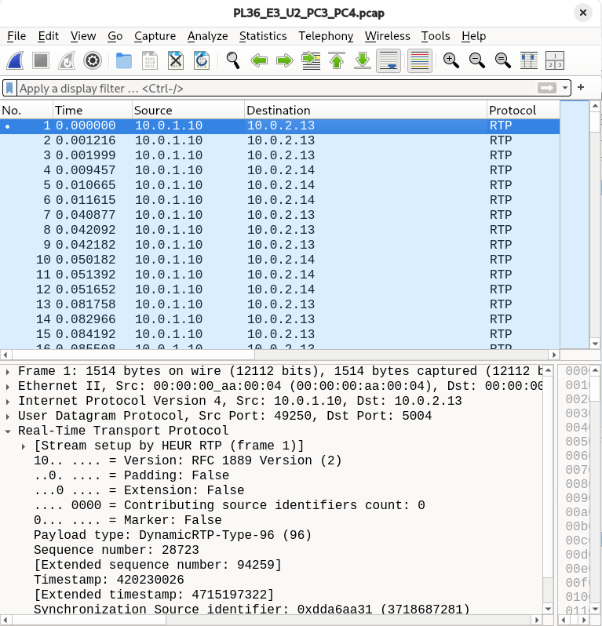
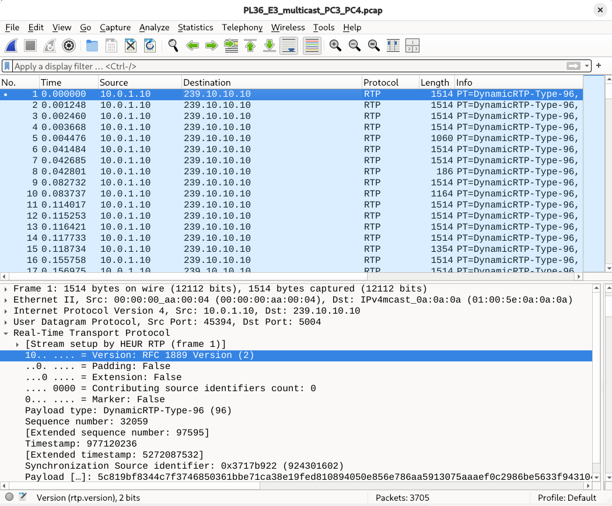

# Stage 3 — RTP/RTCP: unicast vs multicast

The same H.264 video (approximately **1.028 Mbit/s**) was streamed under unchanged **10 Mbit/s, 10 ms one-way delay and 0% configured loss**. Traffic was captured on routerA’s interface toward routerB. PC3 and PC4 played simultaneously in both two-receiver scenarios ([run context](evidence/stage3/logs/PL36_E3_run_context.md)).

## Question 1 — Unicast traffic and scalability

Rates use the first 30 s of each capture: `8 × captured Ethernet frame bytes / 30 / 10⁶`, including RTP and RTCP but excluding physical-link overhead. Analysis selects Streamer UDP traffic to ports 5004/5005 ([analysis](evidence/stage3/measurements/PL36_E3_verified_analysis.json)).

| Capture | Receivers | RTP streams | routerA–routerB rate (Mbit/s) |
| --- | ---: | ---: | ---: |
| [U1](evidence/stage3/captures/PL36_E3_U1_PC3.pcap) | 1 | 1 | 1.074 |
| [U2](evidence/stage3/captures/PL36_E3_U2_PC3_PC4.pcap) | 2 | 2 | 2.132 |
| [Multicast](evidence/stage3/captures/PL36_E3_multicast_PC3_PC4.pcap) | 2 | 1 | 1.074 |

U2 traffic was **1.985 times U1**, approximately doubling as expected for two independent unicast streams. Link rates include packet overhead, unlike the encoded-video bitrate.

Using the measured single-stream rate **R = 1.073592 Mbit/s**, estimated unicast server output is **N × R** and multicast output is approximately **R**:

| Clients | Unicast (Mbit/s) | Multicast (Mbit/s) |
| ---: | ---: | ---: |
| 10 | 10.736 | 1.074 |
| 100 | 107.359 | 1.074 |
| 1000 | 1073.592 | 1.074 |

These are constant-rate extrapolations, not capacity tests; even ten unicast copies exceed the configured 10 Mbit/s link.

## Question 2 — Independent streams in U2

U1 contains RTP from Streamer (**10.0.1.10**) to PC3 (**10.0.2.13**). In U2, RTP packets go to both PC3 and PC4 (**10.0.2.14**) on port 5004, with separate SSRCs `0xdda6aa31` and `0x38172c9f`.

*Figure 1 — U2 capture on routerA–routerB: RTP packets have two unicast destinations.*

## Question 3 — Multicast traffic and replication

The two-receiver multicast capture contains one RTP flow to **239.10.10.10** at **1.074 Mbit/s**. Adding PC4 is expected to leave traffic on the **routerA–routerB link** approximately unchanged; the observed rate is consistent with this, although the join transition was not captured. RouterB sends one copy through `eth1` to sw2, which forwards copies to PC3 and PC4; receiver-side replication occurs at sw2.

*Figure 2 — The multicast capture filter selects traffic to 239.10.10.10; the packet shows the group address and decoded RTP header.*

## Question 4 — RTP and RTCP

RTP **payload type** identifies the media format, **sequence numbers** indicate packet order, **timestamps** provide playback timing, and **SSRC** identifies a stream's source. The first multicast packet in Figure 2 has payload type **96** (H.264 in the SDP), sequence **32059**, timestamp **977120236** and SSRC **`0x3717b922`**. U1's first packet likewise has payload type 96, sequence 10106, timestamp 403605226 and SSRC `0xdda6aa31` ([capture](evidence/stage3/captures/PL36_E3_U1_PC3.pcap)). **RTCP sender reports** appear in all three captures, providing timing information and sender traffic counts alongside the RTP media stream.

## Question 5 — Internet-scale distribution

Multicast avoids duplicate traffic on shared paths, but global services cannot assume multicast routing across providers and access networks. Application-layer distribution through CDN/edge servers uses widely reachable unicast transport while moving replication closer to clients.
